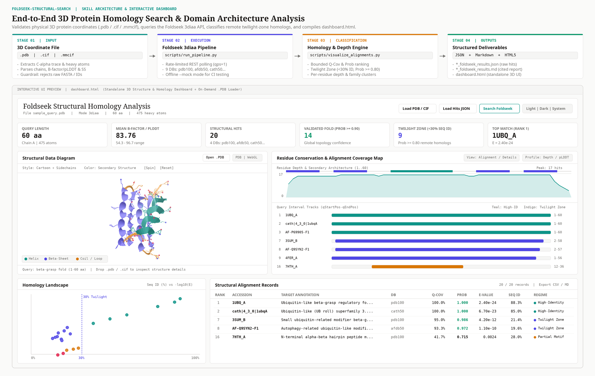

# Foldseek 3D Structural Search & Visualization Skill (`foldseek-structural-search`)

## 1. Overview



`foldseek-structural-search` is an Agent Skill and command-line pipeline for 3D macromolecular structure homology search and domain architecture analysis. Given a 3D protein coordinate file (`.pdb`, `.cif`, or `.mmcif`), the skill submits a structural alignment job in `3diaa` (3Di structural alphabet plus amino acid) mode to the public Foldseek web server REST API (`https://search.foldseek.com/api/`) across up to nine structural databases: RCSB PDB (`pdb100`), the AlphaFold Protein Structure Database (`afdb50`, `afdb-swissprot`, `afdb-proteome`), CATH (`cath50`), ESM Metagenomic Atlas (`mgnify_esm30`), and viral/microbiome structure catalogs (`BFVD`, `bfmd`, `gmgcl_id`).

In structural biology and protein engineering, evolutionary relationships frequently remain conserved in three-dimensional backbone geometry even when primary amino acid sequence identity falls below the 25-30% detection limit of sequence-based alignment methods. This skill provides four integrated analytical capabilities:

- Pre-flight coordinate validation, upstream license recording, and rate-limited (`qps=1`) asynchronous REST API polling.
- Quantitative classification of up to 300 alignments into High-Identity Homologs, Remote Structural Homologs (Twilight Zone), Local / Partial Motif Matches, and Low Confidence hits.
- Per-residue structural conservation depth profiling, secondary structure mapping, and recurring protein family annotation clustering.
- Generation of a standalone HTML5 dashboard (`dashboard.html`) containing an interactive 3D macromolecular viewer (`3Dmol.js` WebGL paired with an offline software 3D projection engine), on-demand `.pdb` / `.cif` file loading, biophysical structure inspection, alignment coverage tracks, sequence-vs-significance scatter plots, and filterable alignment tables.

---

## 2. Non-Technical User Guide

Researchers in structural biology, biochemistry, or translational medicine do not need programming or command-line experience to use this skill. You can work either through natural-language prompts in a SKILL-compatible AI assistant or directly inside a web browser using `dashboard.html`.

### 2.1 Before You Begin: Preparing a 3D Structure File

Foldseek compares three-dimensional atomic coordinates rather than 1D amino acid text sequences. Before running an analysis, make sure you have a coordinate file ending in `.pdb`, `.cif`, or `.mmcif`:

- **Experimental structures (X-ray crystallography, cryo-EM, NMR)**: Download the `.pdb` or `.cif` file from [RCSB Protein Data Bank](https://www.rcsb.org/).
- **Predicted structures**: Download the `.pdb` or `.cif` model from the [AlphaFold Protein Structure Database](https://alphafold.ebi.ac.uk/) using a UniProt accession, or export the coordinate file from your structure prediction workflow.
- **Data governance**: Live Foldseek searches transmit the coordinate file over HTTPS to the public Foldseek server (`https://search.foldseek.com`). Verify institutional approval before submitting confidential or unpublished structures. Inspecting a `.pdb` or `.cif` file locally inside `dashboard.html` without clicking **Search Foldseek** keeps all coordinates in local browser memory.

### 2.2 Workflow A: Using Natural-Language Prompts in an AI Assistant

Place your `.pdb` or `.cif` file in your project folder (for example, `structures/uncharacterized_enzyme.cif` or the included sample `sample_data/sample_query.pdb`) and ask the assistant in plain language.

#### Example 1: Inferring Function for an Uncharacterized AlphaFold Model
Suppose you are studying a hypothetical bacterial protein from a newly sequenced genome. A sequence search returns only "uncharacterized protein" hits, so you download its AlphaFold model (`structures/hypothetical_protein.cif`) to look for distant structural relatives with known biochemical mechanisms.

Prompt:
> "Run a Foldseek structural search on `structures/hypothetical_protein.cif` against `pdb100` and `afdb-swissprot`, save the results in `scratch/hypothetical_study`, build the interactive 3D dashboard, and explain whether any remote homologs suggest a catalytic or binding function."

What happens:
1. The assistant validates the coordinate file, queries experimentally solved structures (`pdb100`) and curated Swiss-Prot models (`afdb-swissprot`), and saves a structured report plus `dashboard.html`.
2. You receive a plain-language summary separating close sequence matches from **Twilight-Zone Remote Homologs** (proteins sharing the same 3D fold with `Prob >= 0.80` despite `< 30%` sequence identity), grouped by recurring protein family descriptions, along with the literature citation.

#### Example 2: Distinguishing Full-Domain Fold Matches from Short Local Motifs
Suppose you solved or modeled a multi-domain receptor fragment (`sample_data/sample_query.pdb`) and want to know whether matching structures share the entire 60-residue beta-grasp fold or only a short N-terminal beta-hairpin.

Prompt:
> "Search `sample_data/sample_query.pdb` across `pdb100,afdb50,cath50`, save outputs to `scratch/domain_check`, and tell me which matches span the full structure versus only a local region."

What happens:
1. The assistant computes Query Coverage (`Q-Cov`) across all hits, distinguishes global fold alignments (`Q-Cov >= 80%`) from partial motif alignments (`Q-Cov < 50%`), and generates `dashboard.html`.
2. Opening `dashboard.html` lets you click any row in the table or alignment map to highlight the exact aligned residue range on the 3D protein model.

#### Example 3: What Happens When Only a Sequence or Accession ID Is Provided
If you ask:
> "Find structural homologs for human hemoglobin subunit alpha (UniProt ID P69905)."

The assistant stops before making any network request, explains that Foldseek requires a 3D coordinate file (`.pdb`, `.cif`, or `.mmcif`), and directs you to download the corresponding coordinate file from AlphaFold DB (`AF-P69905-F1-model_v4.cif`) or RCSB PDB (`1A3N.pdb`) first.

### 2.3 Workflow B: Inspecting `.pdb` and `.cif` Files Directly in a Web Browser (No Command Line)

You can inspect macromolecular structures and explore homology results without running terminal commands:

1. Open `dashboard.html` directly in any modern desktop web browser.
2. Load your own coordinate file on demand using any of three methods:
   - Click **Load PDB / CIF** in the top bar and select a `.pdb`, `.ent`, `.cif`, or `.mmcif` file from your computer.
   - Click **Open .PDB** in the 3D Structure Viewport toolbar.
   - Drag and drop a `.pdb` or `.cif` file directly onto the 3D Structure Viewport.
3. Explore the loaded macromolecule interactively:
   - Use **Style** to switch between `Cartoon + Sidechains`, `Cartoon Ribbon`, `Surface + Cartoon`, `Ball & Stick`, and `Spacefill (VDW)`.
   - Use **Color** to color residues by `Secondary Structure` (alpha-helices vs. beta-sheets), `B-Factor / pLDDT` (crystallographic disorder or AlphaFold confidence), `N-to-C Spectrum`, `Alignment Depth`, or `Chain / Heteroatom`.
   - Inspect the **Structure Details** panel on the right to view Radius of Gyration, 3D Bounding Box dimensions, alpha-helix and beta-sheet percentages, bound `HETATM` cofactors/ligands, chain inventory, secondary structure segments, and the interactive amino acid sequence (click any helix, strand, or residue to highlight it in 3D).
4. Optional live search or result loading:
   - Click **Search Foldseek** in the top bar (when connected to the internet) to submit the currently loaded structure to `pdb100` and `afdb50` and populate all charts and tables automatically.
   - Click **Load Hits .JSON** to pair a previously saved Foldseek JSON result file with your structure, or click **Export CSV** / **Export MD** to download filtered tables for spreadsheets and manuscripts.

---

## 3. Technical Prerequisites & CLI Setup

### System & Runtime Requirements
- **Operating System**: Linux, macOS, or Windows.
- **Python**: Python `3.10` or newer.
- **Package / Script Runner**: Either [`uv`](https://docs.astral.sh/uv/) (supports inline PEP 723 script dependencies automatically) or a standard Python `venv` with `pip`.
- **Network Access**: Outbound HTTPS (`TCP 443`) to `https://search.foldseek.com` is required for live structural searches. Offline execution and automated tests require no network access when invoked with `--mock`.

### Virtual Environment Setup (Standard Python)

```bash
python3 -m venv .venv
source .venv/bin/activate
pip install --upgrade pip
pip install -r requirements.txt
```

---

## 4. Command-Line Execution

All commands below use relative paths executed from the project root directory (`.`).

### 4.1 Run the Automated Test Suite

Execute the unit, smoke, and end-to-end system tests against the bundled synthetic protein fixtures:

```bash
# Using uv
uv run --with pytest --with polite-http pytest -v

# Or inside an activated virtual environment
pytest -v
```

### 4.2 Run the Unified Pipeline (Offline Mock Mode)

Verify end-to-end JSON normalization, Markdown synthesis, and standalone `dashboard.html` compilation offline:

```bash
uv run scripts/run_pipeline.py \
  sample_data/sample_query.pdb \
  -o scratch/mock_run \
  --mock
```

Generated outputs in `scratch/mock_run/`:
- `sample_query_foldseek_results.json`: Raw Foldseek alignment payload.
- `sample_query_foldseek_results.md`: Summary metrics, top homologue interpretations, twilight-zone hits, functional family clusters, and E-value-sorted Markdown table.
- `dashboard.html`: Standalone interactive 3D structure and alignment dashboard.

### 4.3 Run a Live Foldseek Structural Search

```bash
# Default databases (pdb100,afdb50) via unified pipeline
uv run scripts/run_pipeline.py path/to/structure.cif -o scratch/foldseek_out

# Custom databases across PDB, Swiss-Prot AlphaFold models, and CATH domains
uv run scripts/run_pipeline.py path/to/structure.pdb \
  -o scratch/foldseek_custom \
  --databases pdb100,afdb-swissprot,cath50

# Backward-compatible search.py stdout Markdown redirection
uv run scripts/search.py path/to/structure.pdb \
  -o scratch/foldseek_results.json \
  --databases pdb100,afdb50 \
  --dashboard scratch/dashboard.html > scratch/foldseek_results.md
```

### 4.4 Compile `dashboard.html` Directly

```bash
# Compile with existing Foldseek JSON results
uv run scripts/generate_dashboard.py \
  --input_structure sample_data/sample_query.pdb \
  --results_json sample_data/sample_foldseek_results.json \
  --title "Beta-Grasp Fold Homology Analysis" \
  -o scratch/rebuilt_dashboard.html

# Compile a structure-only inspector from a local .pdb or .cif file
uv run scripts/generate_dashboard.py \
  --input_structure sample_data/sample_query.pdb \
  -o scratch/structure_inspector.html
```

---

## 5. Repository Structure

All paths below are relative to the project root directory (`.`):

```text
.
|-- DESIGN.md                                  # Dashboard visual architecture and theme tokens
|-- LICENSE                                    # Apache License 2.0
|-- README.md                                  # Project documentation and user guides
|-- SKILL.md                                   # Primary agent skill instructions and guardrails
|-- SKILL_LICENSES.md                          # Upstream Foldseek service and license notices
|-- dashboard.html                             # Standalone interactive 3D and alignment dashboard
|-- requirements.txt                           # Python runtime and test dependencies
|-- assets/
|   |-- dashboard_payload_schema.json          # JSON Schema for compiled dashboard payload
|   |-- dashboard_template.html                # Parameterized HTML5/CSS/JS dashboard template
|   `-- foldseek_skill_overview.png            # Architecture and dashboard workflow diagram
|-- documents/
|   `-- prd.md                                 # Product Requirement Document
|-- references/
|   |-- citation.bib                           # BibTeX reference entry (vanKempen2023)
|   |-- dashboard_schema.md                    # Dashboard payload field documentation
|   `-- databases_and_metrics.md               # Foldseek database catalog and alignment metrics
|-- sample_data/
|   |-- sample_foldseek_results.json           # Synthetic Foldseek alignment payload fixture
|   |-- sample_query.cif                       # Synthetic 60-residue all-atom mmCIF fixture
|   `-- sample_query.pdb                       # Synthetic 60-residue all-atom PDB fixture
|-- scripts/
|   |-- generate_dashboard.py                  # Standalone HTML5 dashboard compiler
|   |-- run_pipeline.py                        # End-to-end search, report, and dashboard CLI
|   |-- search.py                              # Foldseek REST API client and Markdown emitter
|   |-- visualize_alignments.py                # Alignment normalizer and functional clusterer
|   `-- visualize_structure.py                 # PDB/mmCIF coordinate and secondary structure parser
|-- skills/
|   `-- foldseek_structural_search/            # Standardized skill package directory (relative symlinks)
|       |-- LICENSE -> ../../LICENSE
|       |-- SKILL.md -> ../../SKILL.md
|       |-- assets -> ../../assets
|       |-- references -> ../../references
|       |-- sample_data -> ../../sample_data
|       `-- scripts -> ../../scripts
`-- tests/
    |-- conftest.py                            # Shared pytest fixtures and path configuration
    |-- test_smoke_cli.py                      # Subprocess CLI and guardrail smoke tests
    |-- test_system_pipeline.py                # End-to-end pipeline, dashboard, and repository tests
    |-- test_unit_alignments.py                # Alignment math, regime, and clustering unit tests
    `-- test_unit_structure.py                 # PDB/mmCIF coordinate parser unit tests
```

---

## 6. Citation & Licensing

Code in this repository is licensed under the **Apache License 2.0** (`LICENSE`). Foldseek is developed by the Steinegger Lab (`https://github.com/steineggerlab/foldseek`, GPL-3.0) and accessed via its public REST API (`https://search.foldseek.com/search`). When reporting results generated by this skill, cite:

> van Kempen, M., Kim, S.S., Tumescheit, C., Mirdita, M., Lee, J., Gilchrist, C.L.M., Soding, J., & Steinegger, M. (2023). Fast and accurate protein structure search with Foldseek. *Nature Biotechnology*, 41(12), 1673-1682. https://doi.org/10.1038/s41587-023-01773-0
